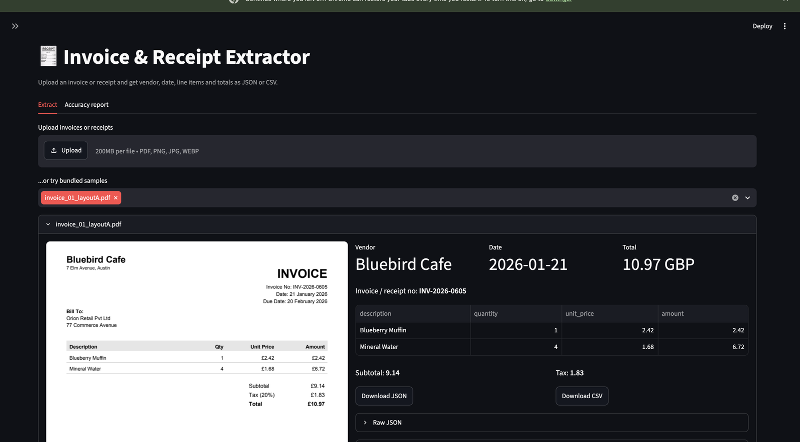

# Invoice & Receipt Extractor (aiTransform)

Upload an invoice or receipt (PDF, PNG, JPG) and get structured data back: vendor, invoice number, date, currency, line items, subtotal, tax and total. Download the result as JSON or CSV. Built with Streamlit.

Live demo: https://invoiceextractor-mu2suvyi68aeadwtrzwbgb.streamlit.app/



The screenshot shows a bundled sample PDF after extraction: vendor, date, total and currency on top, the detected line items in a table, subtotal and tax below, and JSON/CSV download buttons.

## How it works

1. **Upload handling** (`extractor/text_extraction.py`). PDFs with a text layer are read with pdfplumber. Scanned PDFs and images go through RapidOCR (ONNX, installs with pip, no Tesseract needed). OCR boxes are grouped back into visual lines.
2. **Field extraction** (`extractor/parser.py`). A rule-based parser finds vendor, invoice number, date (due dates are ignored), currency, subtotal, tax, total and line items. It handles one-line items (`Widget 2 10.00 20.00`), `2 x Item 5.00` style, and two-line receipt items. A small OCR repair step fixes common mistakes such as `0live` for `Olive`, `f68.56` for `£68.56` and `3, 946.20`.
3. **Optional LLM engine** (`extractor/llm.py`). If `GEMINI_API_KEY` is set, the UI offers a Gemini vision engine that reads the file directly and returns the same schema. This path needs your own key and was not run in the evaluation below.
4. **Output** (`extractor/export.py`). JSON per document, CSV with one row per line item, plus a combined download for batches. The UI also warns when line items do not add up to the subtotal or when subtotal + tax does not equal the total.

### Output schema

```json
{
  "vendor": "Acme Supplies Ltd",
  "invoice_number": "INV-2026-0042",
  "date": "2026-03-14",
  "currency": "USD",
  "line_items": [{"description": "Widget A", "quantity": 2, "unit_price": 10.0, "amount": 20.0}],
  "subtotal": 36.5,
  "tax": 2.92,
  "total": 39.42
}
```

Fields that are not on the document are `null`, never guessed.

## Run locally (VS Code)

Use Python 3.10 to 3.12. Python 3.13 and newer are not supported yet because the OCR library (`rapidocr-onnxruntime`) does not publish wheels for them. Check with `python3 --version`.

**macOS / Linux**

```bash
python3 -m venv .venv
source .venv/bin/activate
pip install -r requirements.txt
cp .env.example .env        # optional, only needed for the Gemini engine
streamlit run app.py
```

**Windows (PowerShell)**

```powershell
python -m venv .venv
.venv\Scripts\activate
pip install -r requirements.txt
copy .env.example .env      # optional
streamlit run app.py
```

If you installed the packages globally instead of in a venv, run the app with `python3 -m streamlit run app.py`. The app opens at `http://localhost:8501`. The first OCR call loads the model, so the first image takes a few seconds longer.

Quick check: pick `receipt_01_clean.png` under "or try bundled samples". You should see vendor `NORTHWIND TRADERS CO`, date `2026-05-21` and total `81.17 USD`.

## Sample data and test set

`python scripts/generate_samples.py` creates **30 self-made documents** in `samples/` with exact ground truth in `samples/ground_truth.json`:

- 13 text PDF invoices in three different layouts
- 2 scanned (image-only) PDF invoices with skew and noise
- 15 receipt images with different noise: clean, rotated, blurred, low JPEG quality, shadow, low contrast, speckle

Currencies are USD, GBP, EUR and PKR, dates use five different formats. Everything is seeded, so results are reproducible. These 30 documents are the test set (`tests/test_samples.py` requires at least 25).

## Per-field accuracy report

Run `python scripts/evaluate.py` (writes `reports/accuracy_report.md`, `.json` and `per_document.csv`). The report is also shown in the app under the "Accuracy report" tab. Vendor uses fuzzy matching (90 percent similarity), amounts must match within 0.01, other fields must match exactly.

| Field | Bundled samples (seed 42) | Held-out samples (seed 2026) |
|---|---|---|
| vendor | 100.0% | 100.0% |
| invoice_number | 100.0% | 100.0% |
| date | 100.0% | 96.7% |
| currency | 90.0% | 86.7% |
| subtotal | 100.0% | 100.0% |
| tax | 100.0% | 96.7% |
| total | 100.0% | 96.7% |
| item description | 100.0% | 97.2% |
| item quantity | 100.0% | 95.3% |
| item unit price | 100.0% | 95.3% |
| item amount | 100.0% | 97.2% |
| **overall** | **99.5%** | **96.4%** |

Read these numbers honestly. The parser was tuned while looking at the bundled samples, so that column is optimistic. The held-out set was generated with a different seed after tuning and is the fairer estimate. Both sets are synthetic and share the same generator, so real-world scans will score lower. Check the held-out failures in `reports/heldout_accuracy_report.md`.

Evaluate on the held-out style set yourself:

```bash
python scripts/generate_samples.py --seed 2026 --out heldout
python scripts/evaluate.py --samples heldout --reports reports_heldout
```

## Known limitations

- Currency is the weakest field. OCR sometimes drops the `€` or `£` sign, and the parser returns `null` instead of guessing.
- Amounts must have two decimals (`12.50`, not `12.5`) and use `.` as the decimal separator.
- English text only. Handwriting, crumpled thermal paper and heavy skew are not handled.
- Unusual invoice layouts (multi-column totals, tax per line) may need new rules, or use the Gemini engine.

## Tests

```bash
pytest -q
```

## Project layout

```
app.py                      Streamlit UI
docs/screenshot.png         screenshot used in this README
extractor/                  text_extraction, parser, llm, pipeline, export, schema
scripts/generate_samples.py builds the 30 samples + ground truth
scripts/evaluate.py         per-field accuracy report
samples/  reports/  tests/
```
